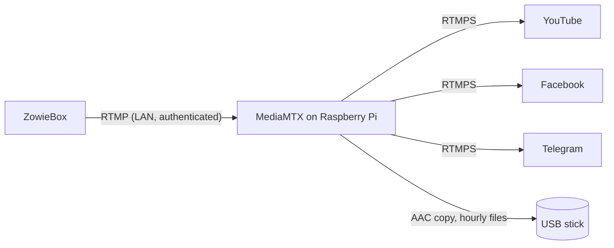

# mediamtx-relay

Multistream relay for the ZowieBox encoder, running on a Raspberry Pi 4.

The ZowieBox can push at most 2 simultaneous streams. This relay accepts **one** stream from it over the LAN and forwards it to **YouTube, Facebook and Telegram**, while archiving the audio track to a USB stick.



- **Forwarding** uses MediaMTX's native `forward` feature (v1.20+). Each destination has its own handler, so a failing platform retries every 5 s without affecting the others.
- **Nothing is re-encoded.** Video and audio are copied as the ZowieBox encoded them, so CPU and RAM use stay low.
- **The archive** is audio only, copied bit for bit from the stream into hourly `.aac` files.

## Repository layout

| File | Purpose |
|---|---|
| `compose.yaml` | Single MediaMTX service (host networking, USB bind mount, secrets via env) |
| `mediamtx.yml` | MediaMTX config: RTMP ingest, auth, audio archive hook. Contains no secrets |
| `.env.example` | Template for `.env`, which holds the version pin, stream keys and publish password |
| `.gitignore` | Keeps `.env` out of Git |

## Prerequisites

- Raspberry Pi 4 running Ubuntu (64-bit), with Docker Engine and the Compose plugin
- Docker starting at boot: `sudo systemctl enable docker`
- DHCP reservations for the Pi and the ZowieBox, both on `192.168.10.0/24`
- Upload bandwidth of at least 3× the stream bitrate, plus headroom
- Platform credentials that don't rotate:
  - **YouTube:** a custom (reusable) stream key, with Auto-start and Auto-stop enabled
  - **Facebook:** Live Producer → Advanced settings → *Persistent stream key*
  - **Telegram:** channel → Live Stream → *Stream with…* (server URL and key). The key stays the same until someone taps *Revoke stream key*.

## Setup

### 1. USB stick for the audio archive

> These steps **erase the stick**. Check the device name first: on a Pi booting from SD, the OS disk is `mmcblk0` and a USB stick is usually `sda`.

```bash
lsblk -o NAME,SIZE,MODEL,FSTYPE,MOUNTPOINTS          # identify the stick (e.g. /dev/sda)

sudo wipefs -a /dev/sda
sudo parted -s /dev/sda mklabel gpt mkpart stream-archive ext4 0% 100%
sudo mkfs.ext4 -L stream-archive /dev/sda1

sudo mkdir -p /mnt/stream-archive
echo "UUID=$(sudo blkid -s UUID -o value /dev/sda1) /mnt/stream-archive ext4 defaults,noatime,nofail,x-systemd.device-timeout=10s 0 2" \
  | sudo tee -a /etc/fstab
sudo systemctl daemon-reload
sudo mount /mnt/stream-archive

# Create the archive directory AFTER mounting, so it exists only on the stick
sudo mkdir /mnt/stream-archive/stream-audio
findmnt /mnt/stream-archive                            # must show /dev/sda1
```

Why it's set up this way:

- **`nofail`** lets the Pi boot normally without the stick. **`noatime`** avoids a write every time a file is read.
- **The UUID** identifies the filesystem, so the mount survives the stick being moved to another port.
- **`stream-audio/` exists only on the stick.** If the stick is missing, the archive hook fails and retries instead of filling the SD card, and forwarding is unaffected.

### 2. Configuration

```bash
git clone <this-repo> /opt/mediamtx-relay && cd /opt/mediamtx-relay
cp .env.example .env && chmod 600 .env
$EDITOR .env
```

| Variable | Value |
|---|---|
| `MEDIAMTX_VERSION` | Exact MediaMTX release, e.g. `1.21.2` (the `-ffmpeg` image variant is used) |
| `ZOWIEBOX_PUBLISH_PASSWORD` | Letters and digits only, since it travels in a URL: `openssl rand -hex 16` |
| `YOUTUBE_STREAM_KEY` | Custom reusable key |
| `FACEBOOK_STREAM_KEY` | Persistent stream key |
| `TELEGRAM_SERVER_URL` | As shown in Telegram but **without the trailing slash**, e.g. `rtmps://dc4-1.rtmp.t.me/s` |
| `TELEGRAM_STREAM_KEY` | Telegram stream key |

### 3. Start

```bash
docker compose config --quiet && echo "config OK"   # fails if any variable is missing
docker compose up -d
docker compose logs -f
```

### 4. ZowieBox

Configure a single RTMP output and disable any other outputs:

| Setting | Value |
|---|---|
| Server | `rtmp://<PI_IP>:1935/live` |
| Stream key | `main?user=zowie&pass=<ZOWIEBOX_PUBLISH_PASSWORD>` |

If the ZowieBox rejects `?` or `&` in the key field, put everything in the server URL instead (`rtmp://<PI_IP>:1935/live/main?user=zowie&pass=…`) and leave the key empty.

Because nothing is re-encoded, the encoder settings must suit all three platforms:

- **Video:** H.264, CBR, 1080p30 at about 4.5–6 Mbps, **2 s keyframe interval**, landscape (Telegram supports landscape only)
- **Audio:** AAC-LC, 48 kHz, stereo, 192 kbps. Facebook accepts up to 256 kbps. Peak levels around −6 dBFS.

## Going live

1. Start streaming on the ZowieBox. YouTube goes live automatically.
2. Facebook Live Producer: click **Go Live**.
3. Telegram: tap **Start Streaming**.
4. To finish, stop the ZowieBox (YouTube ends automatically), then end the broadcasts in Facebook and Telegram.

> With Auto-start enabled, YouTube goes **public** as soon as video arrives. For test runs, set the YouTube stream to Unlisted first.

## Operations

**Forwarding status per platform** (`forwarding`, `error` with `lastError`, or `idle`):

```bash
curl -s "http://127.0.0.1:9997/v3/paths/forward-dests/list?path=live/main"
```

**Logs:** stream keys are stripped from MediaMTX's log output.

```bash
docker compose logs --tail 100
```

**Changing a stream key or password:** edit `.env`, then run `docker compose up -d`. The container is recreated, which briefly interrupts all destinations, so do it between streams.

**Upgrading MediaMTX:** read the release notes, change `MEDIAMTX_VERSION` in `.env`, then:

```bash
docker compose pull && docker compose up -d
```

**Validating `mediamtx.yml`** without starting anything:

```bash
docker run --rm -v ./mediamtx.yml:/mediamtx.yml:ro \
  bluenviron/mediamtx:<version> --validate-conf=/mediamtx.yml
```

### Audio archive

Files are written to `/mnt/stream-archive/stream-audio/` as `YYYY-MM-DD_HH-MM-SS.aac`, one file per hour of streaming, named in the Pi's local time. At 192 kbps that's about 86 MB per hour.

```bash
# Copy the archive to another machine (ext4 isn't readable natively on Windows/macOS)
rsync -av <user>@<PI_IP>:/mnt/stream-archive/stream-audio/ ~/stream-audio/

# Check free space (there is no automatic deletion)
df -h /mnt/stream-archive

# Inspect the newest file
docker exec mediamtx sh -c 'ffprobe -v error -show_entries stream=codec_name,sample_rate,channels,bit_rate -of compact "$(ls -t /recordings/stream-audio/*.aac | head -1)"'
```

- **Removing the stick:** stop the stream first, then run `sudo umount /mnt/stream-archive`.
- **Power loss:** ADTS files have no index or trailer, so a power cut loses only the last few seconds and the rest stays playable.
- **Start-up gap:** the first ~2 s of each stream (one keyframe interval) are not archived while ffmpeg waits for the first keyframe.

## Security

- **Port 1935** must not be forwarded on the router; ingest is LAN only.
- **Publishing** requires the `zowie` credentials **and** a source address in `192.168.10.0/24`. Both are enforced by MediaMTX, which matters because Docker-published ports bypass `ufw`.
- **The Control API** listens on `127.0.0.1:9997` only.
- **`.env`** holds credentials that let anyone broadcast to your channels. Keep it `chmod 600` and out of Git.
- **Telegram:** any channel admin can revoke the stream key. Agree with the other admins not to.

## Troubleshooting

| Symptom | Likely cause |
|---|---|
| `failed to authenticate` in the logs | Wrong password in the ZowieBox, or its IP is outside `192.168.10.0/24` |
| One destination stuck in `error` | That platform's key changed or was revoked: update `.env` |
| Telegram connects but never shows a preview | Trailing slash in `TELEGRAM_SERVER_URL`, or the livestream wasn't opened in the app |
| YouTube shows no data | YouTube requires both video and audio; check the ZowieBox audio input |
| No archive files | Stick not mounted (`findmnt /mnt/stream-archive`), or `stream-audio/` missing on it |
| Container not running after reboot | `systemctl is-enabled docker`; or it was stopped with `docker compose stop` / `down` before rebooting |

## Design notes

- **Native `forward` instead of ffmpeg pushers:** MediaMTX handles RTMPS forwarding, per-destination retries and lifecycle itself, so there are no extra processes or containers.
- **Secrets as `MTX_*` environment variables:** these use MediaMTX's documented env overrides (`MTX_PATHDEFAULTS_FORWARD_<n>_DEST`, `MTX_AUTHINTERNALUSERS_0_PASS`), so `mediamtx.yml` contains no secrets and can live in Git. `live/main` is the only defined path, so it's the only one that inherits the forward destinations.
- **Host networking** is recommended by MediaMTX. It preserves the ZowieBox's real source IP for the subnet check and lets the API bind to the Pi's loopback.
- **The `-ffmpeg` image variant** is needed only for the archive hook. If the archive is ever dropped, switch back to the plain scratch-based image.
