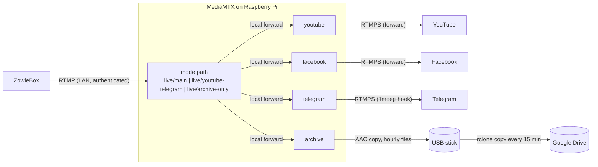

# mediamtx-relay

Multistream relay for the ZowieBox encoder, running on a Raspberry Pi 4.

The ZowieBox can push at most 2 simultaneous streams. This relay accepts **one** stream from it over the LAN and sends it to **YouTube, Facebook and Telegram**, while archiving the audio track to a USB stick and uploading finished archive files to Google Drive with rclone.

The ZowieBox picks a **mode** with its stream key:

| Mode (stream key) | YouTube | Facebook | Telegram | Audio archive |
|---|:---:|:---:|:---:|:---:|
| `main` | ✓ | ✓ | ✓ | ✓ |
| `youtube-telegram` | ✓ | | ✓ | ✓ |
| `archive-only` | | | | ✓ |



- **Modes and outputs:** every destination is an **output path** inside MediaMTX (`youtube`, `facebook`, `telegram`, `archive`), defined once. A **mode path** is just a list of output paths to feed, using local forwards. Adding or changing a mode never touches platform settings.
- **YouTube and Facebook** use MediaMTX's native `forward` feature (v1.20+). Each destination has its own handler, so a failing platform retries every 5 s without affecting the others.
- **Telegram** is pushed by an ffmpeg hook, because Telegram's ingest closes connections from MediaMTX's native RTMP client, while ffmpeg with the same URL and key works. It's an independent process: a Telegram failure doesn't affect the other platforms or the archive.
- **Nothing is re-encoded.** Video and audio are copied as the ZowieBox encoded them, so CPU and RAM use stay low.
- **The archive** is audio only, copied bit for bit from the stream into hourly `.aac` files.

## Repository layout

| File | Purpose |
|---|---|
| `compose.yaml` | Two services: `mediamtx` (relay and archive recording) and `archive-sync` (scheduled upload) |
| `mediamtx.yml` | MediaMTX config: RTMP ingest, auth, modes, output paths, Telegram and archive hooks. Contains no secrets |
| `.env.example` | Template for `.env`, which holds the version pin, stream keys and publish password |
| `archive-sync/` | `Dockerfile` (official rclone image plus pinned, checksum-verified supercronic) and the `crontab` |
| `.gitignore` | Keeps `.env` and `rclone/` (remote credentials) out of Git |
| `AGENTS.md` | Context for AI coding agents: invariants, design decisions, verified facts, validation steps |

## Prerequisites

- Raspberry Pi 4 running Ubuntu (64-bit), with Docker Engine and the Compose plugin
- Docker starting at boot: `sudo systemctl enable docker`
- DHCP reservations for the Pi and the ZowieBox, both on `192.168.10.0/24`
- Upload bandwidth of at least 3× the stream bitrate, plus headroom
- Platform credentials that don't rotate:
  - **YouTube:** a custom (reusable) stream key, with Auto-start and Auto-stop enabled
  - **Facebook:** Live Producer → Advanced settings → *Persistent stream key*
  - **Telegram:** channel → Live Stream → *Stream with…* (server URL and key). The key stays the same until someone taps *Revoke stream key*.

## Setup

### 1. USB stick for the audio archive

> These steps **erase the stick**. Check the device name first: on a Pi booting from SD, the OS disk is `mmcblk0` and a USB stick is usually `sda`.

```bash
lsblk -o NAME,SIZE,MODEL,FSTYPE,MOUNTPOINTS          # identify the stick (e.g. /dev/sda)

sudo wipefs -a /dev/sda
sudo parted -s /dev/sda mklabel gpt mkpart stream-archive ext4 0% 100%
sudo mkfs.ext4 -L stream-archive /dev/sda1

sudo mkdir -p /mnt/stream-archive
echo "UUID=$(sudo blkid -s UUID -o value /dev/sda1) /mnt/stream-archive ext4 defaults,noatime,nofail,x-systemd.device-timeout=10s 0 2" \
  | sudo tee -a /etc/fstab
sudo systemctl daemon-reload
sudo mount /mnt/stream-archive

# Create the archive directory AFTER mounting, so it exists only on the stick
sudo mkdir /mnt/stream-archive/stream-audio
findmnt /mnt/stream-archive                            # must show /dev/sda1
```

Why it's set up this way:

- **`nofail`** lets the Pi boot normally without the stick. **`noatime`** avoids a write every time a file is read.
- **The UUID** identifies the filesystem, so the mount survives the stick being moved to another port.
- **`stream-audio/` exists only on the stick.** If the stick is missing, the archive hook fails and retries instead of filling the SD card, and forwarding is unaffected.

### 2. Configuration

```bash
git clone <this-repo> /opt/mediamtx-relay && cd /opt/mediamtx-relay
cp .env.example .env && chmod 600 .env
$EDITOR .env
```

| Variable | Value |
|---|---|
| `MEDIAMTX_VERSION` | Exact MediaMTX release, e.g. `1.21.2` (the `-ffmpeg` image variant is used) |
| `ZOWIEBOX_PUBLISH_PASSWORD` | Letters and digits only, since it travels in a URL: `openssl rand -hex 16` |
| `YOUTUBE_STREAM_KEY` | Custom reusable key |
| `FACEBOOK_STREAM_KEY` | Persistent stream key |
| `TELEGRAM_SERVER_URL` | Exactly as shown in Telegram, including the trailing slash, e.g. `rtmps://dc4-1.rtmp.t.me/s/` |
| `TELEGRAM_STREAM_KEY` | Telegram stream key |
| `RCLONE_VERSION` | Exact rclone release, e.g. `1.75.2` |
| `RCLONE_DESTINATION` | `<remote>:<folder>`, e.g. `archive:stream-audio` |

### 3. Start

```bash
docker compose config --quiet && echo "config OK"   # fails if any variable is missing
docker compose up -d
docker compose logs -f
```

### 4. ZowieBox

Configure **one** RTMP output and disable any other outputs. The stream key selects the mode:

| Setting | Value |
|---|---|
| Server | `rtmp://<PI_IP>:1935/live` |
| Stream key, mode `main` | `main?user=zowie&pass=<ZOWIEBOX_PUBLISH_PASSWORD>` |
| Stream key, mode `youtube-telegram` | `youtube-telegram?user=zowie&pass=<ZOWIEBOX_PUBLISH_PASSWORD>` |
| Stream key, mode `archive-only` | `archive-only?user=zowie&pass=<ZOWIEBOX_PUBLISH_PASSWORD>` |

Stream in **one mode at a time**. All modes feed the same output paths, so a second mode started in parallel would take over those outputs from the first.

Because nothing is re-encoded, the encoder settings must suit all three platforms:

- **Video:** H.264, CBR, 1080p30 at about 4.5–6 Mbps, **2 s keyframe interval**, landscape (Telegram supports landscape only)
- **Audio:** AAC-LC, 48 kHz, stereo, 192 kbps. Facebook accepts up to 256 kbps. Peak levels around −6 dBFS.

## Going live

1. Set the ZowieBox stream key for the mode you want, then start streaming. YouTube goes live automatically (modes `main` and `youtube-telegram`).
2. Facebook Live Producer: click **Go Live** (mode `main`).
3. Telegram: tap **Start Streaming** (modes `main` and `youtube-telegram`).
4. To finish, stop the ZowieBox (YouTube ends automatically), then end the broadcasts in Facebook and Telegram.

Mode `archive-only` needs no platform steps: starting the ZowieBox starts recording.

> With Auto-start enabled, YouTube goes **public** as soon as video arrives. For test runs, set the YouTube stream to Unlisted first.

## Operations

**What's live right now** (active mode and output paths):

```bash
curl -s http://127.0.0.1:9997/v3/paths/list \
  | python3 -c 'import sys, json; print("\n".join(p["name"] for p in json.load(sys.stdin)["items"] if p["ready"]))'
```

**YouTube and Facebook status** (`forwarding`, `error` with `lastError`, or `idle`):

```bash
curl -s "http://127.0.0.1:9997/v3/paths/forward-dests/list?path=youtube"
curl -s "http://127.0.0.1:9997/v3/paths/forward-dests/list?path=facebook"
```

**Telegram status:** Telegram isn't a forward destination. While it's live, the `telegram` path is ready, and its errors appear in the logs as `[path telegram] runOnOnline command exited`.

**Logs:** stream keys are stripped from MediaMTX's log output.

```bash
docker compose logs --tail 100
```

When a stream ends, ffmpeg's hooks print `Error during demuxing: I/O error`, and the Telegram hook also prints `Failed to update header with correct duration/filesize`. Both are normal: MediaMTX closes the hooks' input when the publisher leaves, and a live FLV output can't be rewritten at the end.

**Changing a stream key or password:** edit `.env`, then run `docker compose up -d`. The container is recreated, which briefly interrupts all destinations, so do it between streams.

**Upgrading MediaMTX:** read the release notes, change `MEDIAMTX_VERSION` in `.env`, then:

```bash
docker compose pull mediamtx && docker compose up -d
```

**Upgrading rclone:** change `RCLONE_VERSION` in `.env`, then rebuild:

```bash
docker compose up -d --build archive-sync
```

**Upgrading supercronic:** change `SUPERCRONIC_VERSION` and **both** checksums in `archive-sync/Dockerfile`, then rebuild the same way. The build fails if a downloaded binary doesn't match its checksum.

**Validating `mediamtx.yml`** without starting anything:

```bash
docker run --rm -v ./mediamtx.yml:/mediamtx.yml:ro \
  bluenviron/mediamtx:<version> --validate-conf=/mediamtx.yml
```

### Audio archive

Every mode records. Files are written to `/mnt/stream-archive/stream-audio/` as `YYYY-MM-DD_HH-MM-SS.aac`, one file per hour of streaming, named in the Pi's local time. File names don't show which mode was used. At 192 kbps that's about 86 MB per hour.

```bash
# Copy the archive to another machine (ext4 isn't readable natively on Windows/macOS)
rsync -av <user>@<PI_IP>:/mnt/stream-archive/stream-audio/ ~/stream-audio/

# Check free space (there is no automatic deletion)
df -h /mnt/stream-archive

# Inspect the newest file
docker exec mediamtx sh -c 'ffprobe -v error -show_entries stream=codec_name,sample_rate,channels,bit_rate -of compact "$(ls -t /recordings/stream-audio/*.aac | head -1)"'
```

- **Removing the stick:** stop the stream first, then run `sudo umount /mnt/stream-archive`.
- **Power loss:** ADTS files have no index or trailer, so a power cut loses only the last few seconds and the rest stays playable.
- **Start-up gap:** the first ~2 s of each stream (one keyframe interval) are not archived while ffmpeg waits for the first keyframe.

### Archive upload (rclone)

The `archive-sync` container runs [supercronic](https://github.com/aptible/supercronic), a cron runner built for containers. It runs `rclone copy` from `archive-sync/crontab` every 15 minutes and uploads finished files to `RCLONE_DESTINATION`. The rclone flags are set as `RCLONE_*` environment variables in `compose.yaml`.

- **Overlapping runs:** supercronic never starts a run while the previous one is still going. Job output goes to `docker compose logs`, and SIGTERM shuts it down cleanly.

- **`rclone copy`, never `sync`:** deleting or losing local files never deletes anything remotely.
- **`--min-age=10m`:** the file MediaMTX is still writing keeps changing its mtime, so it's skipped until the stream (or its hourly segment) ends.
- **`--bwlimit=256k`** (about 2 Mbit/s): uploads can't starve a live stream.
- **Safe without the stick:** the container mounts `/mnt/stream-archive` read-only, and `stream-audio/` exists only on the stick. Without the stick, rclone exits with "directory not found", the run is logged as failed, and the next run retries. Nothing is ever written to the SD card. Thanks to `rslave` propagation, a stick mounted later is picked up without a restart.

**One-time setup:** create the config directory, set up the remote (Google Drive steps below), then test it:

```bash
mkdir -p rclone && chmod 700 rclone
# ... create the remote ...
docker compose up -d --build                          # builds archive-sync on first run
docker compose exec archive-sync rclone lsd archive:  # "archive" = remote name in RCLONE_DESTINATION
```

#### Google Drive remote

1. **Create your own OAuth client.** rclone's shared client ID is being retired during 2026, so this is required. Follow [Making your own client_id](https://rclone.org/drive/#making-your-own-client-id): enable the Google Drive API, configure the consent screen as *External*, add the `https://www.googleapis.com/auth/drive.file` scope, then create an OAuth client of type *Desktop app*.
2. **Publish the app** (Audience → *Publish app*). Apps left in *Testing* get grants that expire after a week, which would silently break the unattended upload. You don't need Google's verification; you'll just click through an "unverified app" warning once.
3. **Authorize through an SSH tunnel**, so no browser or rclone install is needed on the Pi:

   ```bash
   # on your laptop
   ssh -L 53682:localhost:53682 <user>@<PI_IP>

   # in that SSH session, on the Pi
   cd /opt/mediamtx-relay
   docker run --rm -it --network host -v "$PWD/rclone:/config/rclone" \
     rclone/rclone:<RCLONE_VERSION> config
   ```

   Answers: new remote named `archive` (to match `RCLONE_DESTINATION`), storage `drive`, your client ID and secret, scope `drive.file`, no service account, no advanced config. Answer **Yes** to "Use web browser to automatically authenticate", then open the printed `http://127.0.0.1:53682/auth?...` link in your laptop's browser. Answer No to Shared Drive.

`drive.file` lets rclone see only the files it created itself. The Pi can't read or delete anything else in your Drive. Keep using the same client ID: files uploaded by one OAuth client aren't visible to another one.

**Check it:**

```bash
docker compose logs --tail 50 archive-sync

# Upload right now instead of waiting for the next run
docker compose exec archive-sync sh -c 'rclone copy /archive/stream-audio "$RCLONE_DESTINATION"'

# After editing archive-sync/crontab
docker compose exec archive-sync supercronic -test /etc/crontab && docker compose restart archive-sync
```

## Security

- **Port 1935** must not be forwarded on the router; ingest is LAN only.
- **Publishing** requires the `zowie` credentials **and** a source address in `192.168.10.0/24`. Both are enforced by MediaMTX, which matters because Docker-published ports bypass `ufw`.
- **The Control API** listens on `127.0.0.1:9997` only.
- **`.env`** holds credentials that let anyone broadcast to your channels. Keep it `chmod 600` and out of Git.
- **`rclone/rclone.conf`** holds the remote's credentials or OAuth tokens. It's git-ignored; keep the directory `chmod 700`.
- **Telegram:** any channel admin can revoke the stream key. Agree with the other admins not to.
- **Logs can contain the Telegram key.** When ffmpeg fails to connect, it prints the full destination URL, key included. Redact logs before sharing them. YouTube and Facebook keys are always stripped from MediaMTX's own log lines.

## Troubleshooting

| Symptom | Likely cause |
|---|---|
| `failed to authenticate` in the logs | Wrong password in the ZowieBox, its IP is outside `192.168.10.0/24`, or the stream key names a mode that doesn't exist |
| A platform receives the stream when it shouldn't (or the reverse) | The ZowieBox stream key selects the mode: check it, then check the mode's `forward` list in `mediamtx.yml` |
| One destination stuck in `error` | That platform's key changed or was revoked: update `.env` |
| Telegram shows "doesn't see any stream" | Compare `TELEGRAM_SERVER_URL` and `TELEGRAM_STREAM_KEY` with the app (a revoked key or a different `dcN` server); check the logs for `runOnOnline command exited` |
| YouTube shows no data | YouTube requires both video and audio; check the ZowieBox audio input |
| No archive files | Stick not mounted (`findmnt /mnt/stream-archive`), or `stream-audio/` missing on it |
| Archive files not appearing remotely | `docker compose logs archive-sync`; files younger than 10 minutes are skipped on purpose |
| Container not running after reboot | `systemctl is-enabled docker`; or it was stopped with `docker compose stop` / `down` before rebooting |

## Design notes

- **Native `forward` instead of ffmpeg pushers:** MediaMTX handles RTMPS forwarding, per-destination retries and lifecycle itself, so there are no extra processes or containers.
- **Modes as lists of output paths:** each platform is configured once, on its output path. Modes only forward locally (`rtmp://127.0.0.1:1935/<output>`), so `mediamtx.yml` describes every mode without containing a single key. The local hop copies packets on loopback, which costs next to nothing.
- **Secrets as `MTX_*` environment variables:** these use MediaMTX's documented env overrides (`MTX_PATHS_YOUTUBE_FORWARD_0_DEST`, `MTX_PATHS_FACEBOOK_FORWARD_0_DEST`, `MTX_AUTHINTERNALUSERS_0_PASS`), so `mediamtx.yml` contains no secrets and can live in Git. Env overrides can only address path names without `/` or `_`, which is why output paths have simple names like `youtube`. Those paths are declared with `forward: []`, because an empty path entry makes the env override panic in v1.21.2.
- **Host networking** is recommended by MediaMTX. It preserves the ZowieBox's real source IP for the subnet check and lets the API bind to the Pi's loopback.
- **Scheduling with supercronic in a container:** Compose has no scheduling primitive, so the scheduler runs as a container. supercronic is built for that: no sleep loop, no Docker socket, and no extra crontab file on the host. Everything (image, schedule, flags and mounts) is versioned in this repo and deployed with `docker compose up -d`.
- **Telegram via an ffmpeg hook instead of `forward`:** tested on v1.21.2, Telegram's ingest closes connections from MediaMTX's RTMP client immediately (`EOF`), while ffmpeg with the identical URL and key streams fine. The hook lives on the `telegram` output path, so it runs only in modes that include Telegram, and it's independent of the archive hook on the `archive` path.
- **The `-ffmpeg` image variant** is needed by both hooks (Telegram and the archive).
